<h1 align="center">Self-Play Reinforcement Learning for<br>Closed-Loop Motion Planning</h1>

<p align="center">
  <b>Learning to drive on nuPlan without a single human trajectory</b><br>
  CS5478 Intelligent Robots: Algorithms and Systems · Team 21 · National University of Singapore
</p>

<p align="center">
  <a href="https://cheng1559.github.io/nuplan-self-play/"><b>Project page</b></a> ·
  <a href="#results">Results</a> ·
  <a href="#cases">Cases</a> ·
  <a href="#setup">Setup</a> ·
  <a href="#evaluation">Evaluation</a> ·
  <a href="#training">Training</a> ·
  <a href="#visualizer">Visualizer</a>
</p>

<p align="center">
  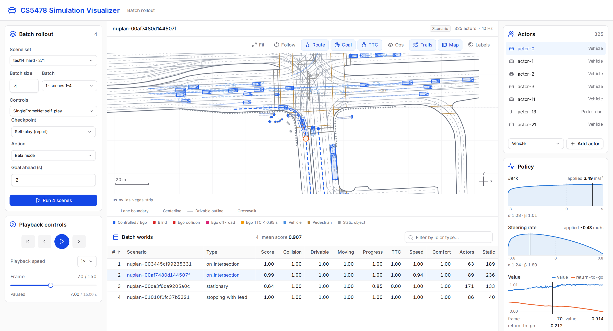
  <br>
  <sub>The visualizer during a self-play batch on Test14-hard: the ego turns right across a busy junction, with per-world nuPlan metrics (bottom) and the policy's action distributions and value (right).</sub>
</p>

## Overview

Learning-based planners are mostly trained to imitate logged human driving, and logs never show how other drivers respond to the planner's own decisions. This repository trains a small driving policy **from scratch with reinforcement learning** instead, and evaluates it with the **official nuPlan devkit**.

- **GPU-batched closed-loop simulator** on nuPlan scenarios. It runs thousands of scenes in parallel and mixes policy-controlled, IDM, rule-based and log-replayed agents in one scene.
- **SingleFrameNet**, a 4.1 M-parameter policy and value network. It reads an agent-centric view of the map, the agents and a route goal 2 s ahead, and outputs Beta distributions over jerk and steering rate.
- **PPO in three settings**:
  - *Replayed traffic*: the ego is the only learner.
  - *Self-play*: one shared policy drives the ego and up to ten vehicles around it.
  - *Self-play + domain randomization*: every agent has its own reward weights, 10% of the agents are blind, and sizes and initial states are perturbed.

  A self-play run collects 37.7 years of simulated driving in 33 hours on 8 GPUs.

## Results

Official nuPlan devkit closed-loop scores (×100): NR is non-reactive traffic, R is reactive traffic.

| Training | Val14 NR | Val14 R | Test14-hard NR | Test14-hard R | Test14-random NR | Test14-random R | Mean |
| :-- | :-: | :-: | :-: | :-: | :-: | :-: | :-: |
| Replayed traffic | 88.93 | 86.32 | 77.35 | 79.42 | 88.19 | 88.78 | 84.83 |
| Self-play | **90.17** | **90.47** | **78.88** | **81.99** | **91.99** | **90.88** | **87.40** |
| Self-play + DR | 87.48 | 90.32 | 78.21 | 81.76 | 88.74 | 90.79 | 86.22 |

The three policies are in [`checkpoints/`](checkpoints): `replay.pt`, `selfplay.pt` and `selfplay_dr.pt`.

## Cases

### Self-play in complex scenes

Test14-hard scenarios in non-reactive traffic. The self-play policy drives the ego (orange); the grey agents and pedestrians replay their logs.

<table>
  <tr>
    <td align="center" width="33%">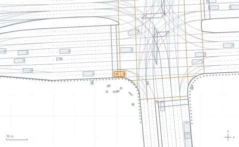<br><sub>Right turn across a busy junction</sub></td>
    <td align="center" width="33%">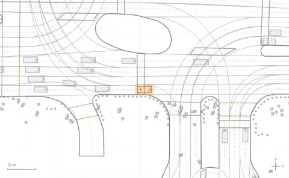<br><sub>Turn past a pedestrian crossing</sub></td>
    <td align="center" width="33%">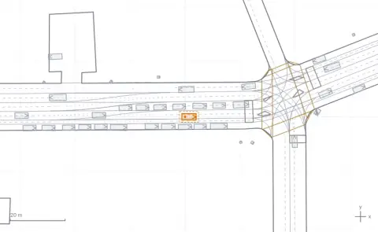<br><sub>Right turn into dense traffic</sub></td>
  </tr>
  <tr>
    <td align="center">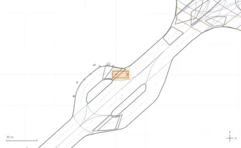<br><sub>Crossing a multi-way intersection</sub></td>
    <td align="center">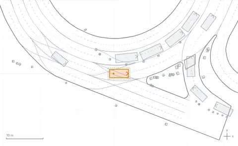<br><sub>Roundabout with merging traffic</sub></td>
    <td align="center">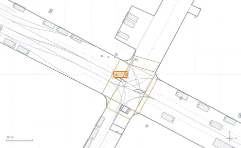<br><sub>Through a crosswalk junction</sub></td>
  </tr>
</table>

### Replayed traffic vs. self-play

Here a lead vehicle brakes (Val14, non-reactive traffic). The policy trained against replayed traffic keeps its speed and rear-ends the lead vehicle after 8.6 s. The self-play policy slows down early and keeps a safe gap.

<table>
  <tr>
    <td align="center" width="50%">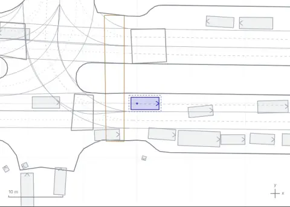<br><sub>Trained with replayed traffic</sub></td>
    <td align="center" width="50%">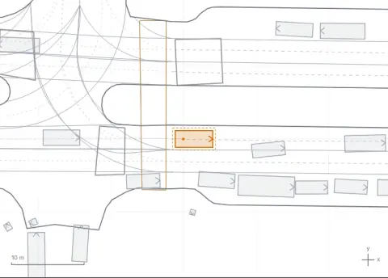<br><sub>Trained with self-play</sub></td>
  </tr>
</table>

<details>
<summary><b>More cases: reactive traffic</b></summary>
<br>

These three scenarios are closed-loop rollouts on Val14 in reactive traffic (our simulator). Blue is the policy trained against replayed traffic and orange the self-play policy. The line is the ego's 15 s trajectory, and the red cross marks the collision of the replay-trained policy.

<p align="center">
  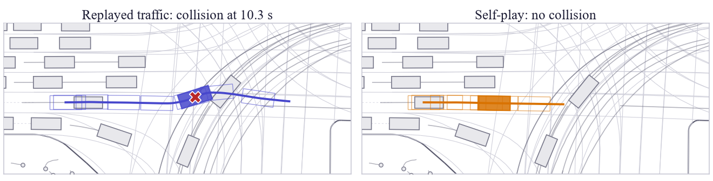<br><sub>(a) Leaving a stop through an intersection</sub><br><br>
  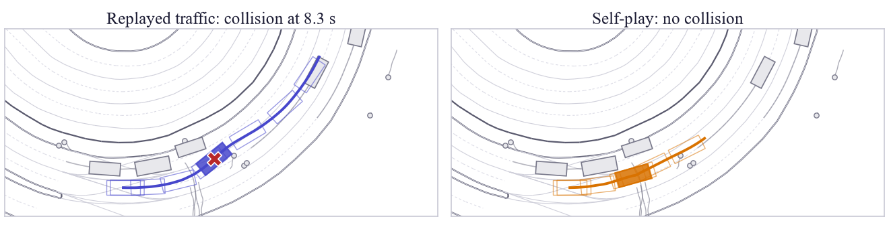<br><sub>(b) Pedestrians crossing a pick-up area</sub><br><br>
  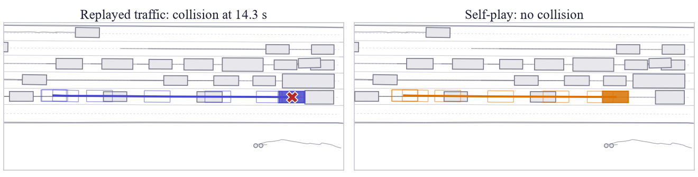<br><sub>(c) Stopping behind a braking lead vehicle</sub>
</p>

</details>

## Repository layout

```text
src/cs5478_project/
  data/         nuPlan scene export (nuplan-export), scene files, batched loader
  datatypes/    fixed-shape tensor contracts (scenes, states, maps, observations)
  agents/       log replay, IDM and rule-based pedestrian agents, policy goals
  dynamics/     kinematic bicycle model and the jerk / steering-rate action adapter
  env/          batched closed-loop environment and agent-centric observations
  evaluation/   nuPlan-style closed-loop metrics and the training reward
  models/       SingleFrameNet (policy and value network), Beta distributions, checkpoints
  training/     PPO (sim-train), self-play world mixing, domain randomization
  nuplan_sim/   SingleFrameNet planner and one-stage controller for the nuPlan devkit
  server/, visualization/, pipelines/, cli/   visualizer backend (sim-visualizer)
web/            visualizer frontend (React + TypeScript)
configs/        nuPlan devkit configs (scenario filters, planner, controller)
scripts/        data splits, export, training, evaluation and analysis
checkpoints/    the three trained policies
assets/         figures and clips for this README
tests/          unit tests
```

## Setup

You need:
- Linux and Python 3.12, with [uv](https://docs.astral.sh/uv/);
- an NVIDIA GPU with CUDA 12.8 drivers, for training;
- Node.js ≥ 22.12, for the visualizer.

The nuPlan devkit is installed from a sibling checkout:

```bash
git clone https://github.com/motional/nuplan-devkit.git ../nuplan-devkit
git -C ../nuplan-devkit checkout e924167
uv sync --locked --extra nuplan-eval
cp .env.example .env   # then set NUPLAN_DATA_ROOT and NUPLAN_MAPS_ROOT
```

The dataset is [nuPlan v1.1](https://www.nuscenes.org/nuplan): the maps and the `train_*`, `val` and `test` log databases under `$NUPLAN_DATA_ROOT/nuplan-v1.1/splits/`.

### Data

**1. Case lists.** Write the evaluation case lists (Val14, Test14-random and Test14-hard, from `configs/nuplan_eval/scenario_filter/`) and the training list. Training windows that overlap an evaluation scenario are dropped.

```bash
uv run --env-file .env python scripts/prepare_nuplan_splits.py --output data/splits \
    --selection dense --workers 32 --name train_full \
    --train-splits train_boston train_pittsburgh train_singapore \
        train_vegas_1 train_vegas_2 train_vegas_3 train_vegas_4 train_vegas_5 train_vegas_6
```

**2. Scene export.** Export the scenes into the simulator's format. The last argument of `export.sh` is the number of processes; each needs one core and about 1.1 GB of memory. The training set takes about 0.55 MB per scene (about 600 GB) and the evaluation sets about 3 GB. Evaluation with the devkit needs only the case lists, not the exported scenes.

```bash
scripts/export.sh data/splits/val14.json data/nuplan/val14 16
scripts/export.sh data/splits/test14.json data/nuplan/test14 16
scripts/export.sh data/splits/test14_hard.json data/nuplan/test14_hard 16
scripts/export.sh data/splits/train_full.json data/nuplan/train_full 96 --min-future 20 --compress
```

## Evaluation

**Official devkit (the report's tables).** `nuplan_closed_loop.py` runs the policy through the devkit's own simulation loop, in NR and R, with a one-stage controller. It uses the Beta mode as the action and a route goal 2 s ahead. It builds the observation online from the devkit's map API, tracked objects and traffic lights. `analyze_results.py` then prints the benchmark table, and writes the paired bootstrap comparisons and the per-scenario-type differences.

```bash
for run in replay selfplay selfplay_dr; do
  uv run --env-file .env python scripts/nuplan_closed_loop.py checkpoints/$run.pt \
      --eval val14=data/splits/val14.json --eval test14=data/splits/test14.json \
      --eval test14_hard=data/splits/test14_hard.json \
      --goal-horizon 2 --workers 32 --output outputs/nuplan/$run
done
uv run python scripts/analyze_results.py --out outputs/analysis \
    --run replay=outputs/nuplan/replay --run selfplay=outputs/nuplan/selfplay \
    --run selfplay_dr=outputs/nuplan/selfplay_dr \
    --pair selfplay:replay --pair selfplay_dr:selfplay
```

For a quick check, add `--limit 8` to `nuplan_closed_loop.py`.

**Our simulator.** This is faster and uses the exported scenes. It is the evaluation run during training; the report explains how it differs from the devkit.

```bash
uv run python scripts/evaluate_checkpoint.py checkpoints/selfplay.pt \
    --eval val14=data/nuplan/val14 --reactive
```

> [!NOTE]
> The policy runs in bf16 with `torch.compile`, so individual scenarios can differ in the last digits between machines and library versions.

## Training

`scripts/train.sh NAME GPUS [options]` runs data-parallel PPO with `torchrun` and writes to `outputs/train/NAME/`. Each of the report's runs used 8 NVIDIA H20 GPUs; `--worlds` is per GPU.

```bash
# Replayed traffic, about 22 h
scripts/train.sh replay 8 --worlds 2048 --rollouts-per-update 4 --epochs 47 --eval-updates 15

# Self-play, about 33 h
scripts/train.sh selfplay 8 --worlds 512 --rollouts-per-update 2 --epochs 9 --eval-updates 20 \
    --log-worlds 0 --self-play-worlds 1

# Self-play + domain randomization, about 32 h
scripts/train.sh selfplay_dr 8 --worlds 512 --rollouts-per-update 2 --epochs 9 --eval-updates 20 \
    --log-worlds 0 --self-play-worlds 1 --domain-randomization --model reward_conditions=true
```

- `uv run sim-train --help` lists all options; their defaults are the report's settings.
- On a single smaller GPU, lower `--worlds` and raise `--rollouts-per-update`, for example `--worlds 256 --rollouts-per-update 8 --store-on-host`.
- `scripts/best_checkpoint.py outputs/train/NAME` prints the checkpoint with the best mean of the in-simulator Val14 NR and R scores. That is the checkpoint the report evaluates with the devkit.

## Visualizer

The visualizer runs batches of scenes in the simulator on demand and plays them in the browser. It has per-actor controls (log, IDM, pedestrian rule, policy), self-play presets, and overlays for goals, observations and metrics.

```bash
(cd web && npm ci && npm run build)
uv run sim-visualizer --artifact-root data/nuplan/val14 --artifact-root data/nuplan/test14_hard
```

To use it:
1. Open <http://127.0.0.1:8000>.
2. Pick a scene set and a preset, for example *Ego SingleFrameNet · R* or *SingleFrameNet self-play*.
3. Pick a checkpoint and run the batch.
4. Click a row of the world table to replay that scene.

## Tests

```bash
uv run pytest
```
